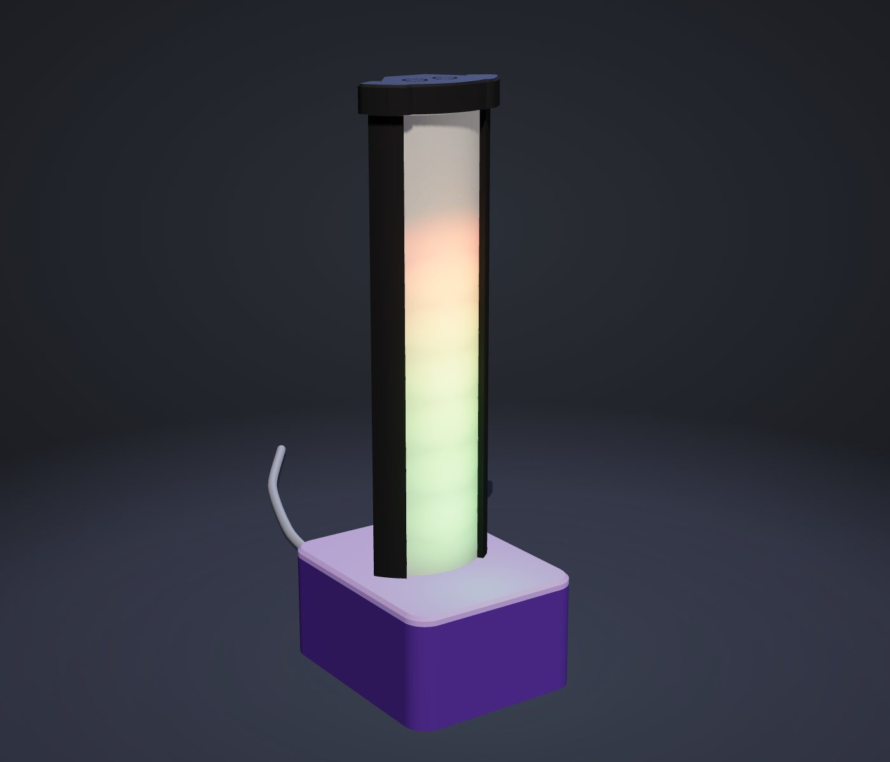

# Lámpara reactiva al sonido

**Una torre de 9 LEDs que escucha el audio del computador y lo convierte en luz.** El navegador analiza el sonido, el Arduino enciende los LEDs y una lámina impresa en 3D difumina la luz.

Taller de Interfaces · Universidad Adolfo Ibáñez · 2026
**Equipo:** José, Pedro Claro y J. Domingo Pastorino



## Ver el proyecto

- **Página del proyecto:** https://pclarow.github.io/lampara-reactiva/
- **App web** (Chrome o Edge, con Web Serial): https://pclarow.github.io/lampara-reactiva/app.html
- **Lámina A3:** [lamina_lampara_A3.pdf](lamina_lampara_A3.pdf)
- **Presentaciones:** [2 páginas](presentacion_2p.pdf) · [3 páginas](presentacion_3p.pdf)

## Ficha

| | |
|---|---|
| Encargo | Arduino + 8 LEDs que reaccionen al sonido |
| Resultado | 9 LEDs WS2812B y 2 botones touch |
| Medidas | 64 × 80 × 200 mm |
| Fabricación | PLA, 5 piezas, 4 h 20 min |

## Cómo funciona

1. **Entrada:** micrófono o el audio del propio computador.
2. **Análisis:** Web Audio mide el volumen, 9 bandas de frecuencia y los golpes del ritmo.
3. **Envío:** Web Serial manda al Arduino el color de cada LED, 30 veces por segundo.
4. **Control:** el Arduino Uno muestra cada cuadro; si el computador se calla, sigue con sus propios modos.
5. **Salida:** 9 LEDs y una lámina curva que convierte los puntos en manchas suaves de luz.

Además, dos botones touch escondidos bajo 0,8 mm de PLA en la tapa superior le avisan a la app de toques, dobles toques y mantener.

## Archivos

```
lampara-reactiva/
├── index.html                  página del proyecto
├── app.html                    app web (Web Serial + Web Audio)
├── lamina.html / .pdf          lámina A3
├── presentacion_2p / _3p       presentaciones (HTML y PDF)
├── lampara_archivos.zip        todos los archivos de fabricación
├── archivos/                   STL de las 5 piezas, STEP y script paramétrico
├── firmware/                   código Arduino y script de avisos
├── img/                        bocetos, pruebas y renders
└── css/site.css                estilos
```
